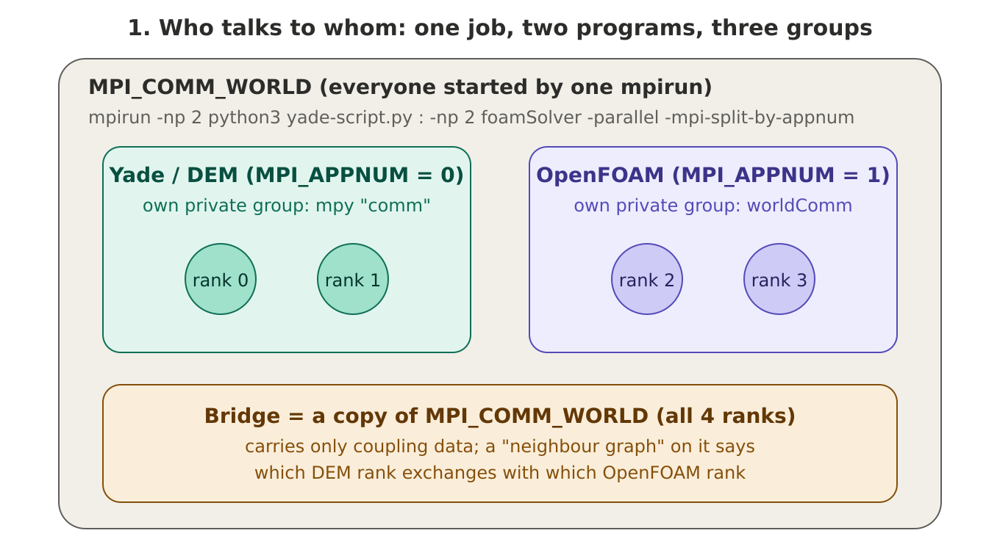
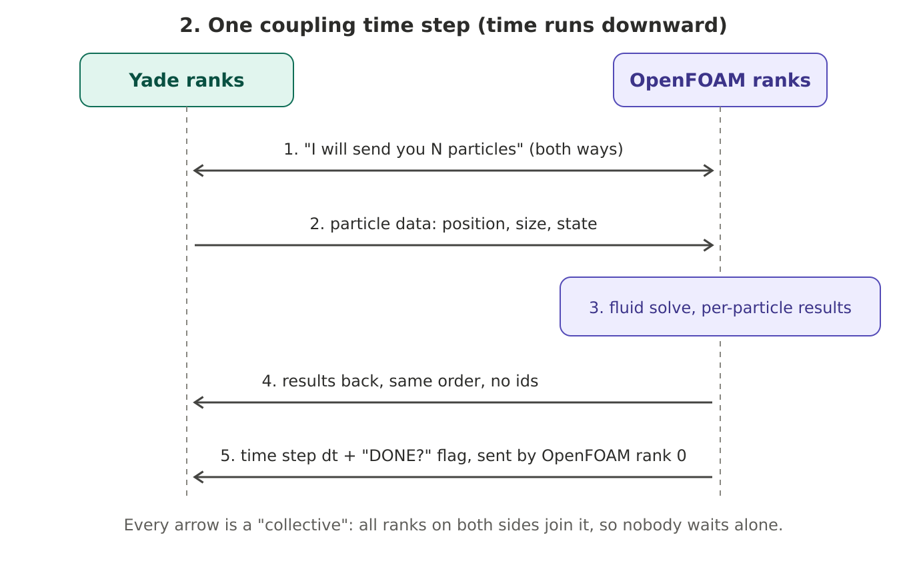
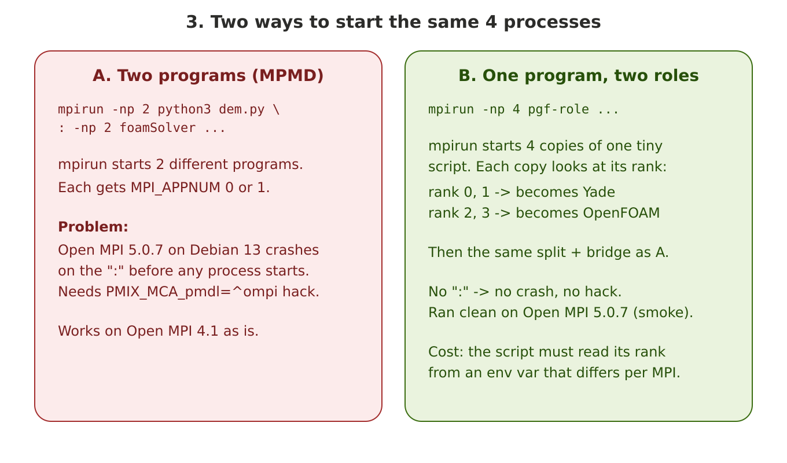

# PgfDemBridge

Coupling bridge between OpenFOAM ([porousGasificationFoam](https://github.com/trymarz/porousGasificationFoam))
and Yade DEM ([yade-pgf](https://github.com/trymarz/yade-pgf)) over MPI: coupling protocol v2.

The plan and the design decisions are tracked in
[porousGasificationFoam#328](https://github.com/trymarz/porousGasificationFoam/issues/328).
The core will be plain C++17 and MPI, used by both sides:
`PgfDemBridge::FoamSide` (an OpenFOAM library in PGF) and `PgfDemBridge::DemSide` (a Yade engine in yade-pgf).

**Status:** only the prototype exists so far. There is no core yet.

## How v2 works

- **Launch.** One `mpirun` starts every Yade process and every OpenFOAM process at the same time. Nothing is spawned later.
- **Private groups.** Each program splits `MPI_COMM_WORLD` into its own private group:
  - OpenFOAM v2606 does this with `-mpi-split-by-appnum`;
  - Yade does it when `yade.mpy` is imported.
- **Bridge.** A copy of `MPI_COMM_WORLD`, used only for coupling data.
- **Handshake.** The first exchange on the bridge checks a magic number, the protocol version and each process's side.
- **Neighbour graph.** Says which DEM process exchanges data with which OpenFOAM process.

- **Each coupling step** is a fixed sequence of collectives, operations that every process joins:
  1. particle counts;
  2. particle data, sent to the OpenFOAM side;
  3. results, sent back in the same order;
  4. `dt` and a DONE flag.
- **Shutdown:** barrier, free the bridge, then each program closes MPI normally. There is no disconnect.
- **Failure:** a fatal error on either side calls `MPI_Abort(MPI_COMM_WORLD)`, which ends both programs.

**Launch option B was chosen.** `mpirun -np N` runs one small start-up script. Each copy reads its rank from the launcher's environment and `exec`s Yade or OpenFOAM.

This avoids a crash on Debian 13: there, Open MPI 5.0.7 segfaults (in PMIx `PMIx_Setenv`) on any `mpirun A : B` command line, i.e. launch option A. The script finds the rank in the first of these variables that is set:

| Launcher | Variable |
|---|---|
| Open MPI 4.x, 5.x | `OMPI_COMM_WORLD_RANK` |
| PMIx-based launchers | `PMIX_RANK` |
| MPICH, Intel MPI (Hydra) | `PMI_RANK` |
| Slurm `srun` | `SLURM_PROCID` |

## Prototype (`prototype/`)

Throw-away code that answered the first box of #328. It will seed the core's mock sides and stress tests.

| Path | Role |
|---|---|
| `common/bridgeProto.H` | Toy core: handshake, graph, teardown |
| `foamSideProto/` | Toy OpenFOAM v2606 app (`wmake`; built to `$FOAM_USER_APPBIN`) |
| `mock/foamMockProto.C` | The same OpenFOAM side without OpenFOAM (`mpicxx`) |
| `demSideProto.py` | mpi4py DEM side; it does the split that `yade.mpy` does |
| `matrix.sh` | Runs layouts 1x1, 2x2, 1x3, 3x1 (DEM x Foam), `REPS` times each, with a 30 s timeout |
| `host-run.sh` | All runs below; Open MPI 4.1 runs in an `ubuntu:24.04` container |
| `role-single-app.sh` | Launch option B |
| `results/` | Run summaries |

Results (all launched with option A, 10 repeats per layout; summaries in `results/`):

| MPI | Foam side | Result |
|---|---|---|
| Open MPI 5.0.7, Debian 13 | v2606 or mock | `mpirun` segfaults before any process starts |
| Open MPI 5.0.7 + `PMIX_MCA_pmdl=^ompi` | v2606 | 40/40 clean |
| Open MPI 5.0.7 + `PMIX_MCA_pmdl=^ompi` | mock | 40/40 clean |
| Open MPI 4.1.6, `ubuntu:24.04` | mock | 40/40 clean |

Launch option B passed a 5-run smoke test on Open MPI 5.0.7 only.

Not run yet:
- option B on Open MPI 4.1 or MPICH;
- the v2606 side on Open MPI 4.1;
- real Yade;
- more than one node.
